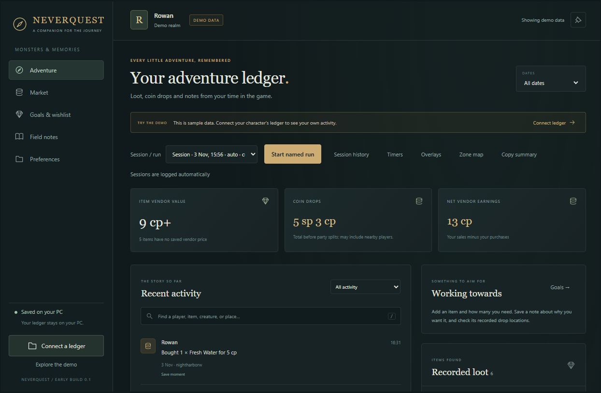
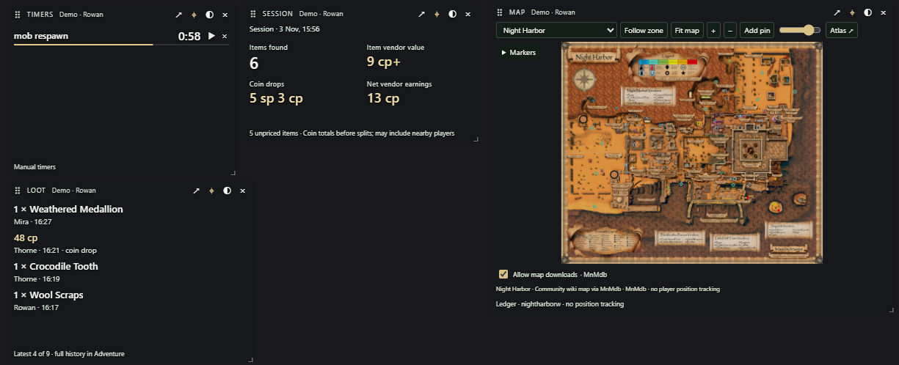

# Neverquest

Neverquest is a Windows companion for **Monsters & Memories**. Keep track of loot, compare player asking prices, collect items for quests and crafting, and save useful notes. Your game records stay on your PC.

This is an early source build. You’ll need Node.js to run it; there’s no installer yet.



## Get started

Install Node.js 22.12 or newer and npm, then run these commands from the project folder:

```powershell
npm ci
npm exec --no -- install-electron
npm start
```

`npm ci` installs the pinned dependencies. The pinned Electron package has no install script, so run `npm exec --no -- install-electron` separately to download the runtime used to run the app. This uses the locally installed Electron package and verifies the download against its bundled checksums by default.

Neverquest opens with **sample data** so you can try it before connecting a character. Choose **Connect a ledger** → **Find game characters**, or select your character’s folder or its `Ledger` folder yourself. A ledger is the set of activity files the game saves for each character.

Neverquest looks for characters here:

```text
%USERPROFILE%\AppData\LocalLow\Niche Worlds Cult\Monsters and Memories\<server>\<character>\Ledger
```

Choose **Explore the demo** to return to sample data. This disconnects the real ledger. Demo changes are temporary and separate from your saved character history.

## Find your way around

- **Adventure:** see recorded loot, coin drops, vendor visits, party changes, gathering, trades and level milestones. Activity is grouped into sessions automatically. Open **Hunt history** to revisit or compare them, or start an optional hunt.
- **Market:** see player buying and selling listings from MnMdb. **Your recorded loot** compares your loot with asking prices on your server. Listings update roughly every six hours. They show what players ask or offer, without confirming completed sales.
- **Goals & wishlist:** choose an item and how many you need. See recorded drop locations, add quest or crafting details, and adjust your progress.
- **Field notes:** write notes about items, creatures, zones and sessions. Use **Save moment** beside an activity to bookmark it here.
- **Preferences:** change the app’s appearance, set up alerts and sounds, open overlays, import or export settings, and choose whether to switch characters automatically.

### Look up an item

Choose an item in the activity feed, recorded loot or goals to see its estimated vendor value, player listings, goal progress and notes. Save a keep/sell decision or add a collection goal from the same place.

**See matching listings** shows sellers and buyers for your server, along with the age of the data. **Open item wiki ↗** opens the item’s page on `monstersandmemories.wiki` in your browser.

The app includes editable quest and crafting notes for four starter items. Each has a source and a date so you can check the details. You can add your own discoveries as you go.

### Sessions and hunts

Choose **Start hunt** to track a solo hunt. Your character is included automatically; optionally add group members, one name per line, including anyone who loots nothing. You can start now or backdate the start. **End hunt** opens its summary. Use **Hunt summary** or **Hunt history** to reopen it. Older named runs remain available as hunts.

For a group hunt, confirm the member list and open **Review item values** to check vendor estimates, enter agreed values per item in whole copper, or explicitly exclude an item. Unpriced items block settlement until resolved. Prices and exclusions apply only to that hunt. Members are treated as present for the whole hunt; nearby players outside the list are excluded.

**Settle loot** assumes everyone keeps the items they looted. It suggests payments to equalise item value; coin drops are already shared evenly and do not affect those payments. Shares use whole copper, with any remainder assigned alphabetically. Vendor estimates can change with recorded sales; agreed overrides remain saved. Check values together before paying.

**Copy settlement** produces item totals, each member’s item value and suggested payments in game-chat messages of at most 240 characters, using `p`, `g`, `s` and `c`. **Copy running summary** works before the hunt ends: values and payments are labelled as provisional. If prices are missing, it shows known values and unpriced counts without payments. Long summaries have separate numbered copy buttons. Solo hunts offer **Copy hunt summary** without payments. The broader **Copy summary** report remains available on the dashboard.

By default, a gap of 30 minutes between recorded activities starts a new session. You can change this in Preferences. Sessions reflect ledger activity, so their duration can differ from your total time in the game.

In **Adventure → Hunt history**, use **Merge with previous…** or **Split session…** to adjust the grouping. Splitting suggests the largest pause and previews the records on each side. Changes are saved for that character and leave ledger records and hunts untouched. **Restore automatic grouping** removes your grouping changes and keeps session names.

### Understand your totals

Item values are estimates based on vendor sales saved for characters on the same server. Neverquest divides each sale by its quantity, then uses the median price per item: the middle price, or the average of the two middle prices. Values are rounded down to whole copper. Items without a recorded vendor price stay **Unpriced**.

Coin drops show the total before party splits and may include nearby players. **Who found what** separates item value, coin looted and personal shares explicitly recorded by the game. Neverquest doesn’t guess how the rest was divided.

**Net vendor earnings** means your sales minus your purchases. It’s separate from estimated item value and coin drops.

Goal progress counts items collected after you create the goal. Adjust it for items you already own or have used; it doesn’t track your current inventory.

Creature details group nearby loot records into estimated loot visits. These can merge separate visits or count a corpse more than once. The percentages describe recorded visits, so they can’t tell you an item’s true chance of dropping from a kill.

### Timers, alerts and settings

Start, reset and stop timers yourself. Their deadlines are saved across restarts. Optional alerts tell you about matching new activity or completed goals; importing old history doesn’t trigger old loot alerts.

Choose the built-in bell or a local WAV, MP3 or OGG file for sounds. Neverquest copies custom sounds into its own data folder.

Settings exports include appearance preferences, goals, alerts, item decisions and reference notes. They leave out ledger history, goal progress, character-folder paths and window positions. Preview an import before applying it. Imported goals start fresh, and custom sound files stay on the original PC.

## Use overlays while you play



Open **Adventure → Overlays** or **Preferences → Overlays** for recent loot, session totals, timers or the zone map.

Use the game in **windowed mode** for reliable overlay interaction. You can also try borderless mode if the game offers it. Full-screen mode can cover overlays when you click or hover over them, even with pinning enabled. Reopening an overlay brings it forward but doesn’t fix full-screen compatibility.

Drag the small handle to move an overlay and its lower-right corner to resize it. Each overlay has controls for pinning, background opacity, closing and opening the companion. New overlays start at 100% background opacity; you can adjust it from 0–100% while the text stays fully visible. Existing saved opacity settings are preserved. Preferences are saved per character.

Choose **Hunt & group** in the overlay picker to follow the active hunt or the most recent finished hunt. Add or remove members directly in the overlay, see item values and projected payments, and copy a running summary or finished settlement. Use **Hunt details** for pricing and the full summary. Smaller windows use Previous/Next buttons for additional members and payments; multi-part copy buttons advance through each chat message.

Overlays show as many loot or timer rows as fit. Resize to see more, or open the companion for the full history.

### Zone maps

The map uses community images and markers from MnMdb. **Map downloads are off by default.** Turn on **Allow map downloads** to download and save maps on this PC. Turning it off cancels current map requests; saved maps that pass validation remain available offline. Market listings and links you open in your browser have separate network access.

Drag to move around the map, zoom in or out, filter markers, and add private pins. Pins stay on your PC. Map-image opacity has its own control, so markers and controls remain visible.

The map follows your zone using zoning messages from the game’s `Player.log`, with the latest ledger zone as a fallback. It doesn’t track your position. Choosing a map yourself pauses zone following. Some zone codes cover more than one area and need a manual choice.

If downloads are off and there’s no saved map for the new zone, you’ll see **No cached map found**. The previous zone’s image and pins are cleared. Enable downloads or choose a saved map to continue. Zones without a supported map have a separate message.

Downloads tell MnMdb which map you requested. Neverquest sends no ledger records, character paths, unrelated log lines or private pins. It checks downloaded files, but those checks can’t guarantee that an image is safe. See [SECURITY.md](SECURITY.md) for the safeguards and their limits.

## Your records and privacy

Neverquest checks the selected character’s ledger and archive every two seconds. It saves imported history locally, so records remain available if the game later removes the original rows. It reports unreadable records and amounts, and keeps unfamiliar actions visible.

Game files are read-only. The app reads Character and Social ledgers and their archive, plus zoning messages from `Player.log` while the map is open. It doesn’t monitor the game process, inspect game windows, read keyboard input or upload your records. Automatic character switching uses ledger file timestamps.

Character history and companion records are saved in `%APPDATA%\Neverquest` on Windows. The main save is `collection.json`, with the previous version in `collection.json.bak`. If saved history can’t be read, Neverquest reports the problem and leaves the file untouched.

Ledgers don’t provide combat statistics, continuous XP tracking, player positions or a guaranteed complete party list. Import both Character and Social ledgers: Neverquest removes duplicate copies while keeping repeated actions within a file.

## Development and checks

Neverquest uses Electron, Node built-ins and browser APIs. Electron 45.2.1 is the only direct dependency. Versions are pinned in `package.json` and `package-lock.json`. There’s no analytics or automatic updater.

```powershell
npm test
npm run check
npm run check:public
npm run smoke
```

The tests cover ledger reading, saved history, sessions, prices, goals, settings and download safeguards. The Electron smoke test uses isolated sample data and hidden app windows. Desktop smoke and manual Windows checks remain pending for this early build. Windows CI is configured for Node 22.12 and Node 24; hosted CI has not yet run.

See [CONTRIBUTING.md](CONTRIBUTING.md) for setup, implementation details and testing guidance, [RELEASE.md](RELEASE.md) for the release checklist, and the [0.2.0 release notes](docs/releases/0.2.0.md) for changes and verification status.

## Licence and data sources

Neverquest’s original code uses the [MIT licence](LICENSE), copyright 2026 Neverquest contributors. Third-party dependencies and downloaded content keep their own licences and attribution requirements. See [THIRD_PARTY.md](THIRD_PARTY.md) for notices.

Maps and player listings come from [MnMdb](https://mnm-db.com/). Starter item notes cite the [community quest index](https://monstersandmemories.wiki/quests) and [Night Harbor Beastmaster starter quest](https://monstersandmemories.wiki/quests/beastmaster-starter-quest-night-harbor). Optional atlas links open [MnM Atlas](https://www.mnmatlas.com/) in your browser.

Neverquest is an independent fan project and isn’t affiliated with or endorsed by Monsters & Memories or its developers.
